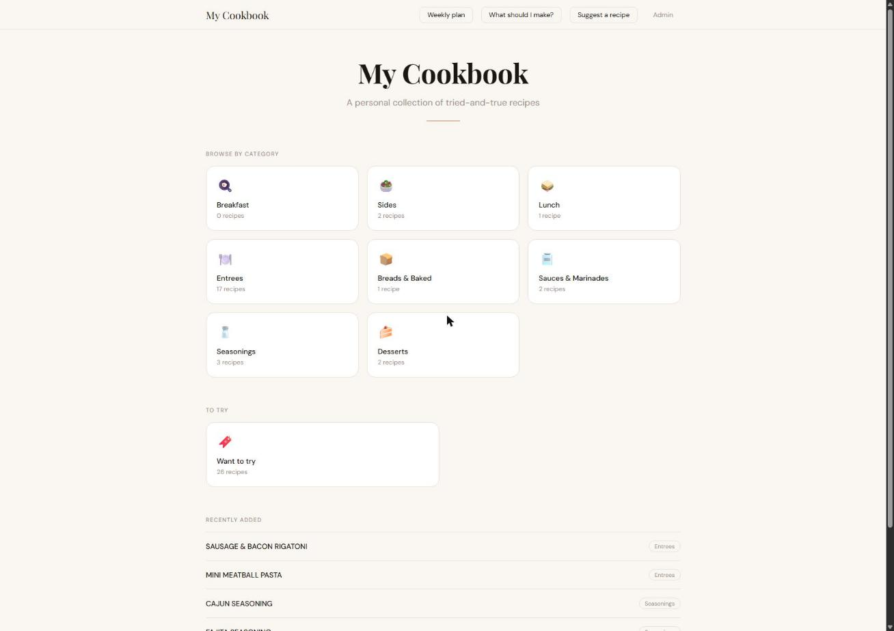

# My Cookbook

[](https://my-cookbook.up.railway.app)

A personal recipe management app. Recipes are organized into categories (Breakfast, Sides, Lunch, Entrees, Breads & Baked, Sauces & Marinades, Seasonings, Desserts) and shown as recipe cards, with an ingredient list and step-by-step instructions grouped by section.



## Features

- Category-based recipe browsing with recipe cards
- Weekly meal plan page
- "What should I make?" ingredient-based recipe finder
- "Want to try" list for recipes not yet cooked
- Add and edit recipes through an admin form, with draft/published status
- Ingredient library shared across recipes
- Recipe suggestions submitted and reviewed through the app

## Tech stack

- **Backend:** Node.js, Express, express-session
- **Database:** PostgreSQL (pg)
- **Frontend:** Server-served HTML, CSS and vanilla JavaScript
- **Hosting:** Railway

## Running locally

```bash
npm install
# set DATABASE_URL and SESSION_SECRET in your environment
npm start
```
